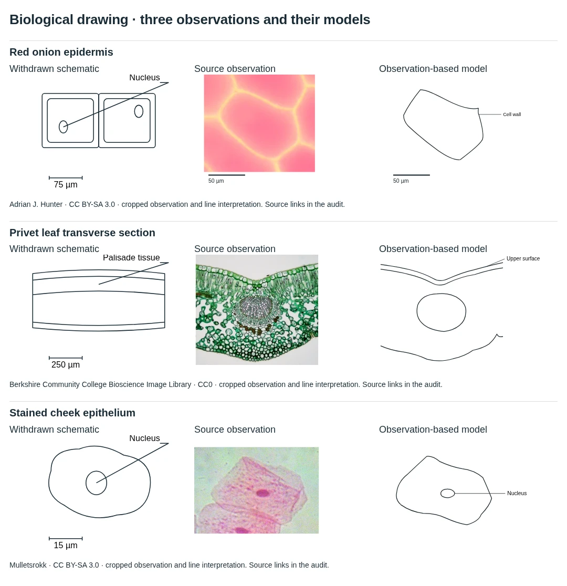

# Biological drawing observation audit

## Withdrawn judgements

Each row covers the eight rendered candidates with the corresponding ID prefix on main at 0f90872. The reference and accepted candidate shared one generated outline. None of the seven had specimen calibration. All 56 judgements were retired, including the seven formerly accepted models. Historical outcomes retain their original IDs and unfinished sets are archived.

| Earlier specimen | Accepted label and biological evidence | Effect on the eight judgements |
|---|---|---|
| Leaf | Long oblique leader crosses the surface to a uniform palisade band. No observed midrib or layer thickness. | The nominal quarter-width bar happens to fit this geometry alone. |
| Stem | Leader reaches the right-hand member of an exactly regular ring of eight identical bundles. | Stretched boundary can intersect the bar. |
| Root | Cortex endpoint sits inside a schematic concentric ring around a geometrically regular cross. | The cell grid crosses multiple tissue regions. |
| Artery | Label runs through the outer wall to a band around a concentric elliptical lumen. | Hatching extends from wall into lumen. |
| Onion | Leader crosses the neighbouring rectangular cell to reach a nucleus. | Removing the nuclei also leaves a label pointing into an empty compartment. |
| Cheek | Long diagonal reaches the centre of the schematic nucleus. | Removing the nucleus creates a second label error. |
| Yeast | Leader approaches overlapping mother and bud outlines and ends inside the maternal outline. | Removing the bud changes the silhouette. The generic internal-detail explanation misdescribes the loss. |

For every prefix, suffix 0 accepted the template, 1 duplicated outlines and added a stray stroke, 2 added hatching at fixed coordinates, 3 inserted a grid or deleted detail, 4 stretched the specimen without relocating its label, 5 sent the leader to a fixed blank point, 6 doubled the scale annotation, and 7 combined the line and hatching changes. The fixed 70-unit bar purporting to represent one quarter of the specimen had no observational basis. Rejected variants inherited problems with their underlying model. Descriptions could give the intended judgement away.

## What the activity checks

AQA 7402 technique AT e includes making observations through drawing. The January 2026 handbook (version 2.3, pp. 54–55) distinguishes cell drawings, tissue maps and post-dissection body plans. The activity teaches cell drawings and partial tissue maps. Each prompt specifies what to record. For uncalibrated crops it assesses shape, position and relative dimensions only. The six feedback categories are local teaching aids. A complete microscope record also needs an explanatory title and a defensible indication of scale or magnification. [AQA practical assessment](https://www.aqa.org.uk/subjects/biology/a-level/biology-7402/specification/practical-assessment) · [AQA practical handbook v2.3](https://cdn.sanity.io/files/p28bar15/green/2563b719d41442e27a14abbb2ae5360b85ca38c9.pdf)

## Observation provenance and calibration

Each line drawing was authored against its displayed photo crop. The photograph and drawing use one isotropic mapping from native image coordinates. If the crop is W units wide, a source length of L units occupies 300 × L / W SVG units in both panels. Enlarging the pair scales the bar with the structures. Ticks, source units and crop boundaries are never treated as physical lengths without source calibration.

| Observation and drawing type | Source and permission | Field and size evidence | Model feature and leader check |
|---|---|---|---|
| Red onion peel, one cell | [Adrian J. Hunter](https://commons.wikimedia.org/wiki/File:Cells_from_a_red_onion_epidermal_peel.tif), [CC BY-SA 3.0](https://creativecommons.org/licenses/by-sa/3.0/) | Existing 998 × 698 WebP. Whole five-segment bar spans x=610–966 inclusive, 357 units for 200 µm. A 50 µm bar spans 89.25 units. | Oblique polygon with an uneven corner and clear interior. Leader ends on the right wall at (461,167). |
| Privet leaf, partial transverse tissue map | [Berkshire Community College Bioscience Image Library](https://commons.wikimedia.org/wiki/File:Angiosperm_Morphology_The_Mesophytic_Dicotyledonous_Leaf_of_Ligustrum_(36845190976).jpg), [CC0](https://creativecommons.org/publicdomain/zero/1.0/) | Resized to 950 × 536 and converted to WebP. The source reports acquisition at 100×. The digital crop has no length calibration. | Upper-surface depression and thin epidermis above the central bundle, with a bulging lower surface. Short oblique leader meets the upper surface towards the right. |
| Buttercup root, transverse tissue map | [Jon Houseman, source credited to Jon Houseman and Matthew Ford](https://commons.wikimedia.org/wiki/File:Ranunculus_root.jpg), [CC BY-SA 4.0](https://creativecommons.org/licenses/by-sa/4.0/) | Resized to 840 × 750 WebP. Black bar at x=682–804 inclusive spans 123 units for the source’s 0.31 mm. The drawing reproduces this as 310 µm. | Broad cortex and small cylinder containing four-armed xylem. Cortex leader ends inside the outer tissue at (704,434). |
| Arterial wall, partial tissue map | [FishtailBob](https://commons.wikimedia.org/wiki/File:ArteryVeinCS.jpg), [CC BY-SA 4.0](https://creativecommons.org/licenses/by-sa/4.0/) | 640 × 480 field converted to WebP. Crop isolates the thick-walled artery next to the vein. No reliable length calibration. | Inner and outer edges of the dark muscular band, oblique lumen and uneven inner contour. Leader reaches the lumen at (353,177). The task explicitly excludes the adjoining tissue. |
| Cheek epithelium, one cell | [Mulletsrokk](https://commons.wikimedia.org/wiki/File:Cheekcells_stained.jpg), [CC BY-SA 3.0](https://creativecommons.org/licenses/by-sa/3.0/) | Existing 880 × 660 WebP. Crop isolates the upper of the overlapping central cells. No reliable length calibration. | Angular ridge, broad right side and small dark oval nucleus. A straight leader from the right reaches the nuclear boundary at (432,248). |
| Human erythrocyte, one cell | [MDougM](https://commons.wikimedia.org/wiki/File:Sedimented_red_blood_cells.jpg), public domain | Existing 386 × 404 photograph. White bar at x=244–365 inclusive spans 122 units for 20 µm. A 5 µm bar spans 30.5 units. | The fluorescent boundary is slightly taller than wide. Diffuse changes in brightness are left unoutlined. The leader reaches the right edge at (334,234). |
| Paper task, neighbouring onion cell | Same Hunter photograph and licence as the first row | Separate crop, x=437–651 and y=72–296, with the same underlying calibration. | Upright cell with an inward bend on its left. The model labels its right wall at (616,201). It is revealed only when the learner is ready to compare. |

All listed licences permit cropping, conversion and line adaptations. Each credited adaptation is offered under the corresponding source terms. The full-field photograph is accessible from every judgement. The comparison sheet reproduces the credited onion, privet and cheek panels under their respective terms.

## Assessment decisions and visual alternatives

All 18 live candidates were rendered beside their source and visually checked during authoring. Each row below records the distinction that the drawing, feedback and readable comparison must communicate. The two descriptions give the same types of spatial evidence across variants of each specimen. The learner must decide which observed differences matter for the stated task.

| Specimen and variant IDs | Judgement | Visible evidence and feedback |
|---|---|---|
| epidermis.outline | Accept | One cell follows the observed polygon, leader touches the wall, 50 µm bar spans one quarter of the original. |
| epidermis.leader | Reject, label endpoint | The tip lies inside the cell about 38 units from the wall. Extend it to the boundary. |
| epidermis.bar | Reject, scale | The quarter-length bar reads 100 µm. Relabel it 50 µm or double its length for 100 µm. |
| privet.outline | Accept | Thin upper band, dip, main bundle and lower bulge follow the photograph without cellular detail. |
| privet.band | Reject, proportions | The inner epidermal boundary takes in deeper tissue. Restore the narrow band seen along the upper surface. |
| privet.cells | Reject, biological detail | Five partitions reproduce individual cells within the upper band. Retain only tissue boundaries for this task. |
| buttercup.outline | Accept | Small central cylinder, four-armed xylem and broad cortex preserve the observed size relationships. |
| buttercup.core | Reject, proportions | The cylinder occupies about a third of the width rather than the observed seventh. Reduce the cylinder boundary. |
| buttercup.xylem | Reject, biological detail | The ring is empty. Include the visible four-armed tissue while leaving out individual vessels. |
| arterial.outline | Accept | The uneven oblique lumen is enclosed by a substantial muscular band. The line reaches the lumen. |
| arterial.rim | Reject, proportions | Enlarging the lumen leaves a thin rim. Restore the thicker wall at the lower right. |
| arterial.hatch-tip | Reject, shading and label endpoint | Sloping strokes fill part of the band and the lumen leader ends in it. Remove the hatching and lead into the enclosed space. |
| buccal.outline | Accept | The upper overlapping cell retains its angular outline. The small oval nucleus is labelled at its boundary. |
| buccal.nucleus-size | Reject, proportions | The enlarged nucleus spans nearly half the width. The source shows about one seventh. Its leader still reaches it. |
| buccal.sketch | Reject, line quality | Overlapping strokes repeat the left contour. Record the upper cell edge with one continuous line. |
| redcell.outline | Accept | A single elongated contour, the observed right edge and a correctly proportioned 5 µm bar. |
| redcell.interior | Reject, biological detail | A bounded internal oval has no counterpart in the field. A mature human erythrocyte has no nucleus. |
| redcell.bar | Reject, scale | A quarter of the source bar is labelled 10 µm. Its length represents 5 µm. |

## Learning journey and verification

The worked example pairs the micrograph and model. A toggle locates the same high corner in both. The explanation traces the wall, justifies leaving the interior clear and calculates the bar. The first judgement in each set offers guided practice on onion epidermis. The remaining five draw on different specimens. Three sets cover all eighteen candidates, with persisted question IDs for an unfinished set.

The paper task uses a different cell. The learner draws it in pencil, checks wall shape, label and scale, and records one improvement. Reopening restores the checklist and text. Printing with the paper task open produces the credited reference and instructions. The exercise awards no objective drawing score.

Verification included an image-by-image author review, a comparison of anatomical landmarks and leader endpoints, source-image bar measurements, decoded photos and pixel differences in each rendered defective candidate. Browser tests traverse all three sets, incorrect verdicts, category selection, clues, first attempts, review, reload and old progress. The accessibility checks include neutral evidence, keyboard-operated enlargement, touch layouts, 150% text, four viewport widths, automated WCAG checks and print isolation. The test file records the independent coordinates and expected edits. [Rendered drawing checks](../scripts/check-drawing-observations.mjs) · [Exam Skills suite](../scripts/check-alevel-exam.mjs)

The activity has no dissection-based body plan. Stem and budding yeast require separately sourced, legible observations before reinstatement. Uncalibrated fields remain relative-proportion exercises. No independent teacher sign-off, screen-reader user trial or observed pupil drawing trial was available. Drawing-production competence requires inspection of a learner’s work.
