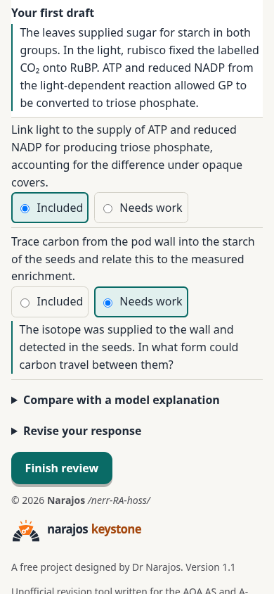
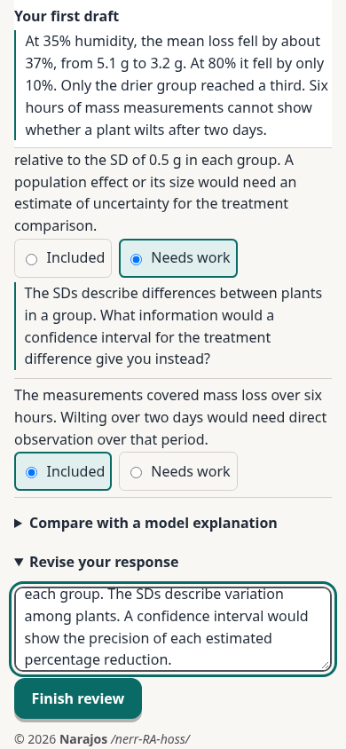
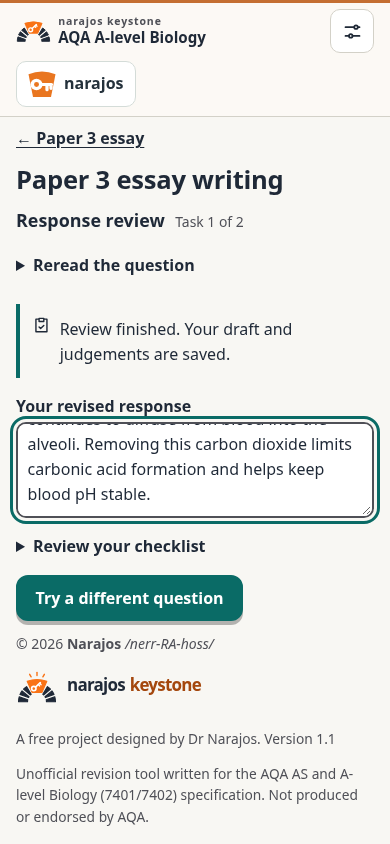

# A-level Biology paper practice in the browser

The screenshots use demonstration responses and follow the controls available to pupils. They were captured in Chromium at 100% zoom on a 390 × 844 touch viewport and a 1280 × 900 desktop viewport.

## Mobile self-review and revision

Start with the whole checklist, then follow one missing point through feedback, revision and a saved response after reload. Each of the last three images shows a single phone screen. In the essay revision, the pupil has scrolled the original answer to the second paragraph to compare its ending with the revision.

| Pathway | First draft and criteria | Selected “Needs work” prompt | Edit with the original in view | Saved response |
| --- | --- | --- | --- | --- |
| Paper 2 comprehension | [Whole checklist](passages/self-review-mobile.webp) | [Carbon transfer into the seed](passages/feedback-mobile.webp) | [Revise the explanation](passages/revision-mobile.webp) | [After reload](passages/saved-mobile.webp) |
| Paper 3 investigations | [Whole checklist](investigations/self-review-mobile.webp) | [Variation among plants](investigations/feedback-mobile.webp) | [Revise the evaluation](investigations/revision-mobile.webp) | [After reload](investigations/saved-mobile.webp) |
| Paper 3 essay writing | [Whole checklist](essaywriting/self-review-mobile.webp) | [Why removal matters](essaywriting/feedback-mobile.webp) | [Develop the paragraph endings](essaywriting/revision-mobile.webp) | [After reload](essaywriting/saved-mobile.webp) |

## Paper 2 comprehension

The worked coral example connects membrane damage to the alga’s sugar supply. The pupil then enters the pea-pod investigation and writes an explanation of the isotope results. After reviewing the draft, the pupil opens a fresh passage about the sensory response of a pond insect.

| View | Mobile | Desktop |
| --- | --- | --- |
| Worked example with the question and a step in the explanation | [Mobile](passages/worked-mobile.webp) | [Desktop](passages/worked-desktop.webp) |
| Pea-pod passage, measurements and command | [Mobile](passages/question-mobile.webp) | [Desktop](passages/question-desktop.webp) |
| First response in the writing field | [Mobile](passages/response-mobile.webp) | [Desktop](passages/response-desktop.webp) |
| First response and all four self-review criteria | [Mobile](passages/self-review-mobile.webp) | [Desktop](passages/self-review-desktop.webp) |
| Next independent passage on the insect sensory neurone | [Mobile](passages/next-mobile.webp) | [Desktop](passages/next-desktop.webp) |

## Paper 3 investigations

The worked example compares oxygen uptake in stirred and unstirred seed batches. The independent investigation asks the pupil to evaluate a leaf-film supplier’s claim at two humidities. The next investigation changes the experimental design and the outcome measure to mowing dates and butterfly sightings.

| View | Mobile | Desktop |
| --- | --- | --- |
| Worked comparison of seed-batch measurements | [Mobile](investigations/worked-mobile.webp) | [Desktop](investigations/worked-desktop.webp) |
| Bean experiment, measurements and supplier’s claim | [Mobile](investigations/question-mobile.webp) | [Desktop](investigations/question-desktop.webp) |
| First evaluation in the writing field | [Mobile](investigations/response-mobile.webp) | [Desktop](investigations/response-desktop.webp) |
| First evaluation and all four self-review criteria | [Mobile](investigations/self-review-mobile.webp) | [Desktop](investigations/self-review-desktop.webp) |
| Next independent evaluation of a meadow study | [Mobile](investigations/next-mobile.webp) | [Desktop](investigations/next-desktop.webp) |

## Paper 3 essay writing

The worked example develops the importance of membranes using two different areas of biology. The independent task supplies a title about the removal of substances. The pupil chooses examples, writes two paragraphs and uses the criteria to improve them. A second title asks about movement within cells.

| View | Mobile | Desktop |
| --- | --- | --- |
| Worked essay example and a developed biological link | [Mobile](essaywriting/worked-mobile.webp) | [Desktop](essaywriting/worked-desktop.webp) |
| First title and writing task | [Mobile](essaywriting/question-mobile.webp) | [Desktop](essaywriting/question-desktop.webp) |
| Two paragraph openings in the writing field | [Mobile](essaywriting/response-mobile.webp) | [Desktop](essaywriting/response-desktop.webp) |
| First two paragraphs and all four self-review criteria | [Mobile](essaywriting/self-review-mobile.webp) | [Desktop](essaywriting/self-review-desktop.webp) |
| Next independent essay title on movement within cells | [Mobile](essaywriting/next-mobile.webp) | [Desktop](essaywriting/next-desktop.webp) |

