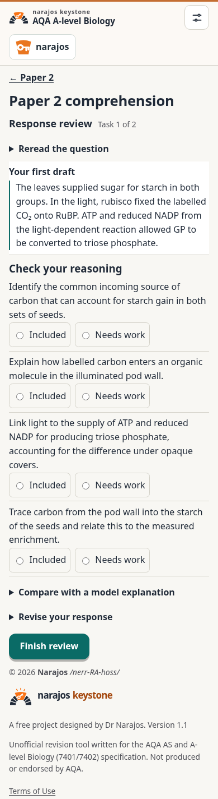
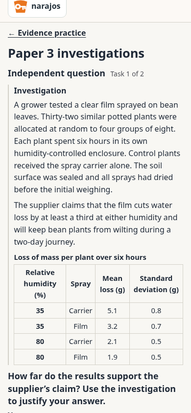
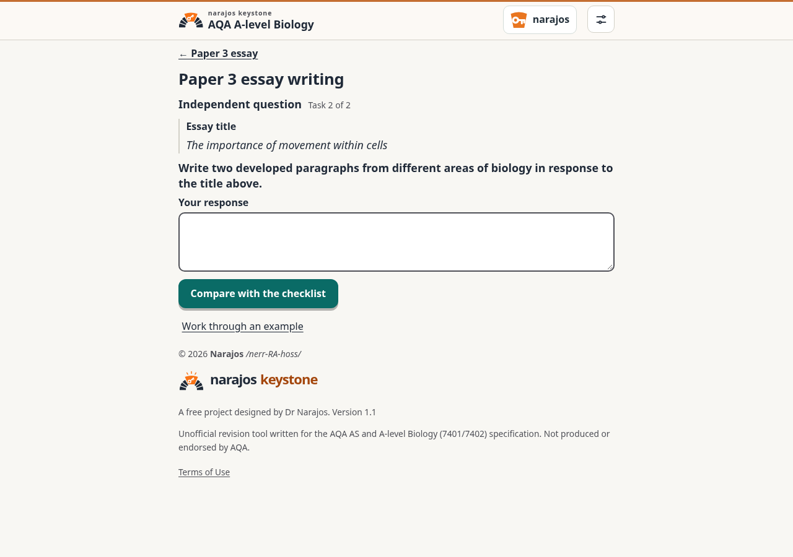

# A-level Biology paper practice in the browser

Each row opens the original screenshot at its captured size. The mobile viewport was 390 × 844 CSS pixels with touch emulation. The desktop viewport was 1280 × 900. Both used Chromium at 100% zoom. Self-review images show the whole document at that viewport width so every criterion is visible. The other images show one screen. The captures follow the controls a pupil can use on the site. The response examples were written for this review.

## Paper 2 comprehension

The worked coral example connects membrane damage to the alga’s sugar supply. The pupil then enters the pea-pod investigation and writes an explanation of the isotope results. After reviewing the draft, the pupil opens a fresh passage about the sensory response of a pond insect.

| View | Mobile | Desktop |
| --- | --- | --- |
| Worked example with the question and a step in the explanation | [Mobile](passages/worked-mobile.webp) | [Desktop](passages/worked-desktop.webp) |
| Pea-pod passage, measurements and command | [Mobile](passages/question-mobile.webp) | [Desktop](passages/question-desktop.webp) |
| First response in the writing field | [Mobile](passages/response-mobile.webp) | [Desktop](passages/response-desktop.webp) |
| Self-review of the missing carbon source | [Mobile](passages/self-review-mobile.webp) | [Desktop](passages/self-review-desktop.webp) |
| Next independent passage on the insect sensory neurone | [Mobile](passages/next-mobile.webp) | [Desktop](passages/next-desktop.webp) |

## Paper 3 investigations

The worked example compares oxygen uptake in stirred and unstirred seed batches. The independent investigation asks the pupil to evaluate a leaf-film supplier’s claim at two humidities. The next investigation changes the experimental design and the outcome measure to mowing dates and butterfly sightings.

| View | Mobile | Desktop |
| --- | --- | --- |
| Worked comparison of seed-batch measurements | [Mobile](investigations/worked-mobile.webp) | [Desktop](investigations/worked-desktop.webp) |
| Bean experiment, measurements and supplier’s claim | [Mobile](investigations/question-mobile.webp) | [Desktop](investigations/question-desktop.webp) |
| First evaluation in the writing field | [Mobile](investigations/response-mobile.webp) | [Desktop](investigations/response-desktop.webp) |
| Self-review of the treatment comparison at 35% humidity | [Mobile](investigations/self-review-mobile.webp) | [Desktop](investigations/self-review-desktop.webp) |
| Next independent evaluation of a meadow study | [Mobile](investigations/next-mobile.webp) | [Desktop](investigations/next-desktop.webp) |

## Paper 3 essay writing

The worked example develops the importance of membranes using two different areas of biology. The independent task supplies a title about the removal of substances. The pupil chooses examples, writes two paragraphs and uses the criteria to improve them. A second title asks about movement within cells.

| View | Mobile | Desktop |
| --- | --- | --- |
| Worked essay example and a developed biological link | [Mobile](essaywriting/worked-mobile.webp) | [Desktop](essaywriting/worked-desktop.webp) |
| First title and writing task | [Mobile](essaywriting/question-mobile.webp) | [Desktop](essaywriting/question-desktop.webp) |
| Two paragraph openings in the writing field | [Mobile](essaywriting/response-mobile.webp) | [Desktop](essaywriting/response-desktop.webp) |
| Self-review of the sites of removal | [Mobile](essaywriting/self-review-mobile.webp) | [Desktop](essaywriting/self-review-desktop.webp) |
| Next independent essay title on movement within cells | [Mobile](essaywriting/next-mobile.webp) | [Desktop](essaywriting/next-desktop.webp) |

