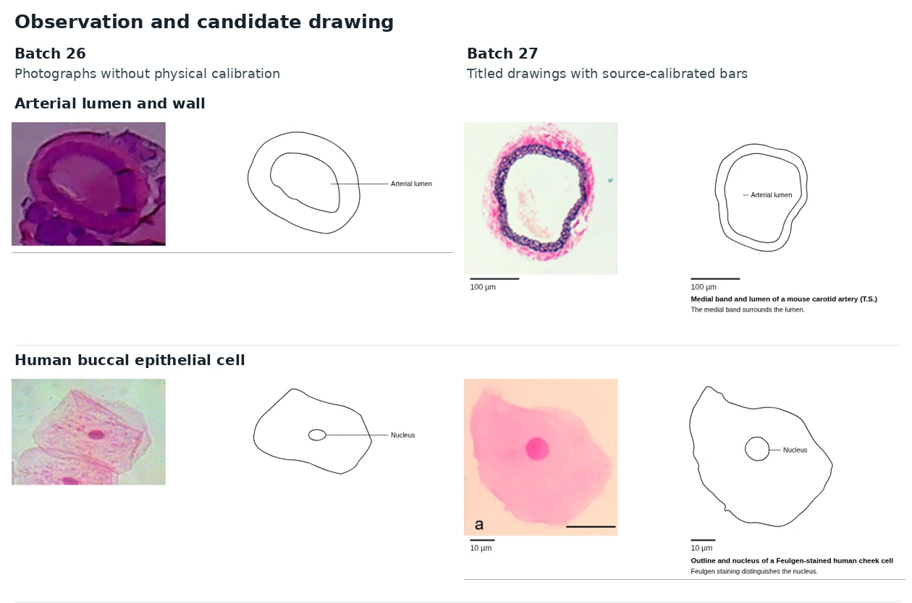

# Batch 27 · AQA A-level biological drawing

## Audit at the start of the batch

Batch 26 was merged in [PR #78](https://github.com/mnarajos/Narajos-site/pull/78). Main was at `9014f39`, with no outstanding pull requests and passing site, browser and accessibility checks. We rendered the source field beside every candidate in the six sets, including the neighbouring onion cell used for independent paper drawing. The following judgements concern the activity at that commit.

| Observation | What the pupil could validly judge | Limitation of the earlier presentation |
|---|---|---|
| Red onion epidermis | The outline of one cell, the wall label and the calibrated 50 µm bar | The clear interior makes a good exercise in omission. It gives a beginner little evidence on which to base a decision about internal structures. |
| Privet leaf transverse section | Surface position, epidermal thickness, central bundle and the distinction between a tissue boundary and cell divisions | No specimen length calibration. A positive verdict on the tissue boundaries could be read as endorsing a complete drawing. |
| Buttercup root transverse section | The outer contour, relative size of the vascular cylinder and the central xylem, against a source bar of 0.31 mm | Suitable material for a complete drawing once the title is attached and the task specifies the extent of the map. |
| Arterial wall transverse section | The unequal thickness of the selected band around an oblique lumen | No specimen length calibration. The source field alone cannot establish actual lumen diameter or drawing magnification. |
| Stained cheek epithelium | The outline of a selected overlapping cell and the size and position of its nucleus | No specimen length calibration. A good outline and nuclear label establish only part of a complete record. |
| Human erythrocyte | The outer contour of one fluorescent cell and a calibrated 5 µm bar | An internal difference in brightness does not justify drawing a separate organelle. |

All six accepted candidate graphics relied on the surrounding page to identify the preparation. The generic candidate heading itself did not supply an explanatory drawing title. Three candidates had a valid size bar. Three had no defensible indication of physical size or drawing magnification. None of the latter three was suitable for an independent judgement that the whole drawing was complete.

## Standard used for review

AQA technique AT e concerns scientific drawing from observation with annotation. The handbook distinguishes drawings of visible cell structures, maps showing the distribution of tissues, and drawings of structures exposed by dissection. The purpose determines which details and annotations belong. A complete drawing carries an explanatory title and indicates real size or magnification. A calibrated bar is one way to indicate real size. The microscope setting alone cannot establish the magnification of an illustration on a changing screen. [AQA 7402 practical assessment, AT e](https://www.aqa.org.uk/subjects/biology/a-level/biology-7402/specification/practical-assessment) · [AQA Practical Handbook, version 2.3, January 2026, pp. 54–55](https://cdn.sanity.io/files/p28bar15/green/2563b719d41442e27a14abbb2ae5360b85ca38c9.pdf)

Earlier records include the [Batch 24 specimen and licence register](alevel-drawing-batch-24.md) and [Batch 26 assessment audit](assessment-batch-26.md).

## What pupils now see

The worked example opens with a Wright–Giemsa-stained tiger frog blood smear. Pupils inspect the whole cell, decide which internal boundaries they can defend, then reveal the drawing. Its nucleus is visibly enclosed and occupies about three tenths of the width of the cell. The paler region surrounding it is identified as cytoplasm. Gradual changes of stain have no separate contours. The model carries its own explanatory title, labels and calibrated 5 µm bar. The worked comparison and the assessment photographs can be enlarged and switched in place. [Worked example, source plate, annotated decisions and visual before/after](drawing-worked-source.md)

| Active specimen | Meaning of a successful judgement | Size evidence for the model |
|---|---|---|
| Red onion epidermis | Complete for the task of outlining and labelling an observed wall. It also gives practice in leaving an unresolved interior clear. | 50 µm uses 89.25 image units, one quarter of the original 357-unit, 200 µm bar. |
| Privet leaf midrib | **Focused practice only.** “Features match” refers to the selected tissue boundaries, their proportions and the omission of cell subdivisions. A pupil cannot accept this as a complete drawing. | The photograph preserves both leaf surfaces and the main vascular bundle. Its acquisition magnification gives no physical calibration for the resized field. Four alternative sources were investigated. |
| Buttercup root transverse section | Complete for the specified map of the root surface, cylinder and xylem. The xylem lobes now follow the ends of the vessel groups. The cortex label and its leader fit inside the cortex. | The photographed bar represents 0.31 mm. Its 123 image units represent 310 µm. |
| Mouse carotid artery transverse section | Complete for the specified medial band and lumen. The trace follows the same dark tissue at both edges around the section. The pale tissue outside that band is distinguished in the prompt. | Brown and colleagues give one 100 µm calibration for all four micrographs of Figure 1A. Its dark bar occupies about 164 image units. |
| Human cheek epithelial cell | Complete for the cell outline and stained nucleus. The new single control cell replaces an overlapping pair and has its own source bar. | Batran and colleagues’ 198-unit bar represents 20 µm. The 10 µm bar on the drawing uses 99 units. |
| Human erythrocyte | Complete for the resolved outer profile. The darker region inside has no distinct enclosing boundary. | The model uses 30.5 units for 5 µm, one quarter of the 122-unit, 20 µm source bar. |

Left panels adapted from *ArteryVeinCS* by FishtailBob, CC BY-SA 4.0, and *Cheekcells stained* by Mulletsrokk, CC BY-SA 3.0. Each adaptation retains its source licence. Right panels adapted from Brown et al. (2025), Figure 1A, and Batran et al. (2025), Figure 5a, each CC BY 4.0. Images have been cropped, converted and paired with the drawings rendered by the activity. The cheek source is a preprint. The activity uses its labelled control micrograph and scale. [Earlier photographs and licences](alevel-drawing-batch-24.md) · [Carotid photograph, crop, licence and trace](drawing-artery-source.md) · [Cheek photograph, licence, measurements and privet source investigation](drawing-calibration-search.md)

The buttercup resizing question still asks for an independent numerical answer. The observed span is 246 / 123 × 0.31 mm = 0.62 mm. On a drawing where that span measures 36 mm, a 100 µm bar should measure 36 × 0.10 / 0.62 = **5.8 mm** to one decimal place. Magnification changes with the displayed length. An attached bar changes length with the specimen and continues to represent the same physical distance.

The paper task uses a different calibrated onion cell. Pupils draw before revealing its model, then review proportions, relevant detail, line quality, labels, title, annotation and bar. The printable prompt omits the model. The checklist and written improvement are self-review. Earlier drawing judgements are archived with their original attempts. Revised questions start with fresh evidence. The calculation, paper notes and previously applicable paper checks retain their original meaning.

## Verification and limitations

The [individual judgement register](biological-drawing-review-27.md) covers every accepted and rejected candidate, with separate reviews of the worked example and paper model. The authoring and review passes were conducted separately. Reviewers inspected the rendered drawings beside source photographs, traced entire label lines, checked outlines against photographic landmarks and checked feedback against the actual defect. External human biology-teacher moderation remains outstanding.

The browser suites exercise all 18 verdicts, their defect categories, neutral accessible descriptions, keyboard focus, touch enlargement, historical score separation and the paper and calibration tasks. Mobile checks cover 320 px and 390 px portrait, short landscape, tablet and desktop widths, enlarged text and genuine browser zoom. The tests check that pupils can switch between corresponding views while enlarged. The detailed comparison is available on a phone without requiring a second device.

The calibrated figures support the specific structures named in their prompts. A single optical section cannot establish a three-dimensional shape, and a lack of resolution cannot establish that a cell lacks a particular structure. The models distinguish visible boundaries from stain patterns wherever that affects the judgement.

The local site validation passed for 42 pages and 221 local links. Chromium passed the complete visual/accessibility suite, the A-level exam journey and the dedicated drawing scenarios. The drawing suite reported no WCAG A/AA findings in the states it exercised. A follow-up moved the worked frog cell’s label text into the margin. The drawing test checks the position of the text and the endpoint of each separate label line. The hosted workflow runs include Chromium with real 200% browser zoom, Firefox, WebKit and the synthetic performance sample. [Batch 27 changes and commits](https://github.com/mnarajos/Narajos-site/pull/79/commits) · [Hosted check results](https://github.com/mnarajos/Narajos-site/pull/79/checks)

The first hosted Firefox and WebKit runs caught three long titles extending beyond their drawing sheets. Shorter explanatory titles retain the specimen, preparation or view and fit across the tested browser fonts.
