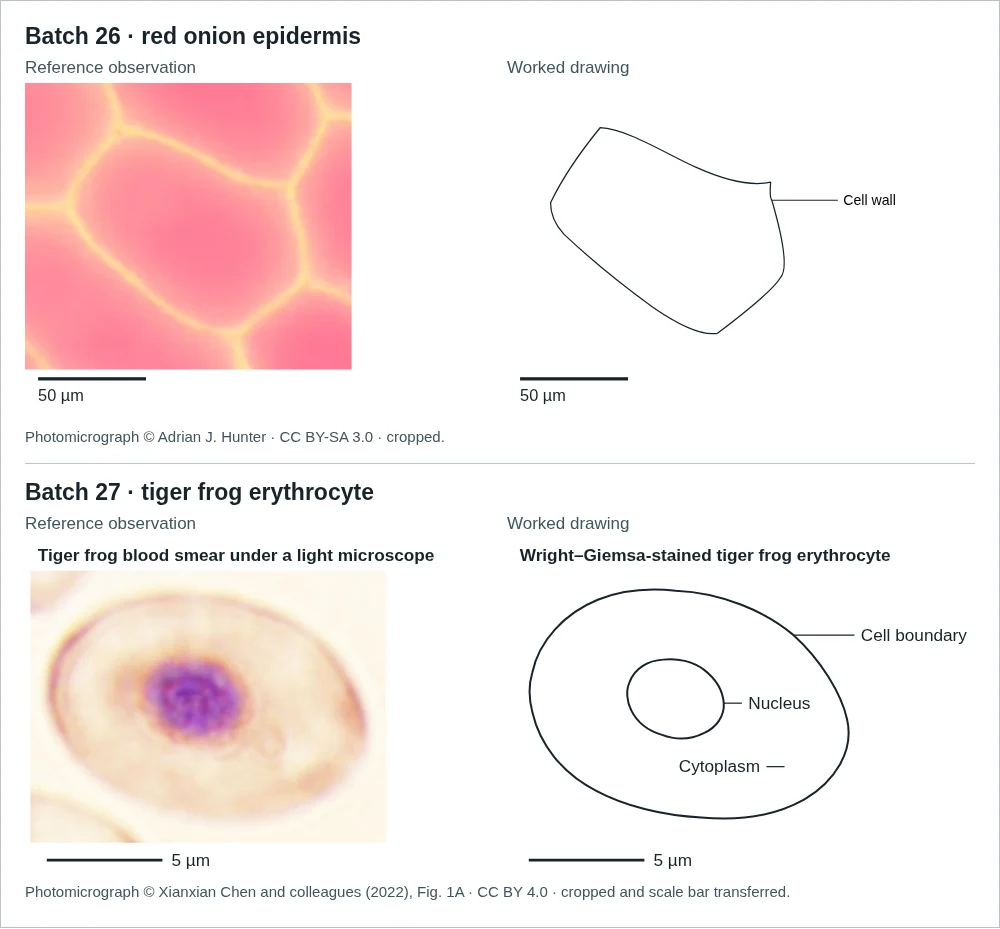

# The worked cell drawing, Batch 27

The first example now asks the learner to use the edge of a whole cell, the position and proportions of its stained nucleus, and the pale cytoplasm around it. The former red onion example offered one clearly traceable wall, but no internal structure with a distinct boundary. It remains valuable for teaching when to leave the interior clear.

The upper pair comes from main at `9014f39`. Its photograph is Adrian J. Hunter’s *Cells from a red onion epidermal peel*, cropped from the existing WebP. The onion adaptation in this comparison retains CC BY-SA 3.0. The lower pair contains the new photograph credited below. Each pair has its own calibration. [Onion source](https://commons.wikimedia.org/wiki/File:Cells_from_a_red_onion_epidermal_peel.tif) · [CC BY-SA 3.0](https://creativecommons.org/licenses/by-sa/3.0/)

## Source and licence

| Item | Evidence |
|---|---|
| Photograph | *Wright–Giemsa staining of tiger frog blood cells*, Figure 1A in *Morphology and cytochemical patterns of peripheral blood cells of tiger frog (Rana rugulosa)*, PeerJ 10:e13915, 29 August 2022. |
| Creators | Xianxian Chen, Yu Wu, Lixin Huang, Xue Cao, Misbah Hanif, Fei Peng, Xiaobing Wu and Shengzhou Zhang. |
| Primary source | [Article](https://doi.org/10.7717/peerj.13915) · [Figure 1 and caption](https://doi.org/10.7717/peerj.13915/fig-1) · [Publisher’s full-resolution plate](https://dfzljdn9uc3pi.cloudfront.net/2022/13915/1/fig-1-full.png) · [Indexed article and figure descriptions](https://pubmed.ncbi.nlm.nih.gov/36061754/) |
| Authenticity | The authors describe preparing a peripheral blood smear, staining it with Wright–Giemsa and photographing it with an Olympus BX61 light microscope. Their arrow in panel A identifies an erythrocyte, and their caption describes its pale red-brown cytoplasm. |
| Permission | The authors publish the work under [CC BY 4.0](https://creativecommons.org/licenses/by/4.0/), which permits cropping and adaptation with attribution. Photo credit, a link to the figure, licence and changes accompany the learner-facing photograph. |
| Original file | RGB PNG, 3201 × 1817. SHA-256 `95818018045ff6d3b99be6a527cf6b4715c02cfb42bb1420753180238e3a41b1`. |
| Local file | The upper-left 780 × 590 rectangle, with top-left at (0, 0), saved as [lossless WebP](../public/assets/micrographs/drawing-tiger-frog.webp). This file retains the original arrow and calibration bar. No retouching, recolouring or resampling. SHA-256 `360bd289cea3525c32ff92f4e1eebf6dcf52bd6d93a96df76b36a8c1c76a74ab`. |
| Displayed field | A 392 × 300 native-pixel rectangle starting at (256, 208), ending immediately before (648, 508). It contains the whole designated erythrocyte. The source arrow and printed bar fall outside this field. A few fragments of neighbouring cells remain at its edges. |

## Calibration

The figure caption gives 10 µm for the solid black bar. At native resolution, its uninterrupted horizontal rows at y = 554–559 contain black pixels from x = 31 through x = 285, inclusive. Its width is 255 pixels. These measurements refer specifically to the publisher’s full PNG and the unresized local panel.

The conversion is 255 ÷ 10 = 25.5 image units per micrometre. A 5 µm bar therefore spans 127.5 units. The reference and model each place that line from x = 24 to 151.5 on their own SVG drawing sheet, outside the cropped photograph. The 516 × 374 viewports, 1:1 representation of source distances inside each SVG, and common (6, 35) crop origin keep observations registered when comparing them. Browser scaling changes the bar and specimen by the same factor. The published image bar is the calibration reference. The authors’ instrument settings and screen pixel density do not enter this calculation.

## Observational choices

| Feature | Drawing decision and check |
|---|---|
| Cell | Trace the broad oblique silhouette, with rounded left end, high upper edge just left of centre, and lower right end. Preserve the gently uneven outline rather than substituting a symmetric oval. The cell-boundary label touches the upper-right slope at crop coordinate (310, 71). |
| Nucleus | The dark purple enclosed region is just left of the cell centre. Its horizontal span is about 107 native pixels against about 350 for the cell. Trace the boundary of the whole stained region. The nuclear leader ends on its right boundary at (233, 146). |
| Cytoplasm | The lightly stained area lies between those boundaries. The cytoplasm leader ends within this region at (308, 216). It remains unshaded. The two internal leaders pass through the outer cell edge once. The three straight leaders never cross each other. |
| Omitted detail | Neither mottled staining within the nucleus nor the faint patches in the cytoplasm provide sufficiently resolved boundaries and identities to warrant separate structures. The crop does not resolve a membrane bilayer. The model uses a single outer contour and includes only the selected whole cell. |
| Title and annotation | The model sheet itself names the specimen and stain. The worked text explains how to annotate the effect of staining when an annotation is requested. |
| Review | The rendered pair and a native-coordinate contour overlay were visually inspected. Independent project reviewers checked the photograph, eight contour landmarks, ends and extent of all three leaders and original calibration. A separate reviewer also inspected the rendered pair at 320 px. These were project checks. External biology-teacher sign-off remains outstanding. |

The worked example is an observation-and-reveal exercise, with no learner judgement or score. It creates no historical attempt or automatic credit. [Worked example implementation](../public/alevel/drawing-worked.js)
