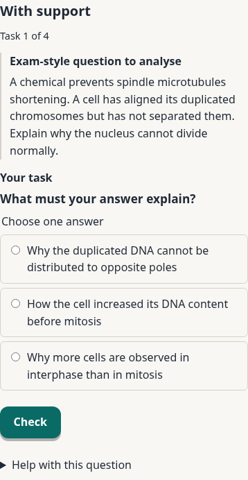

# Exam Skills stimulus and task

In **Understand the question → With support**, the original exam-style question sits under **Exam-style question to analyse**. **Your task** introduces the actual choice the student needs to make.

[View the same activity at 320 px](understand-question-320.png)

Tasks with a separate scenario, graph or data table follow the same reading order. The wording, response options and marking are retained.
