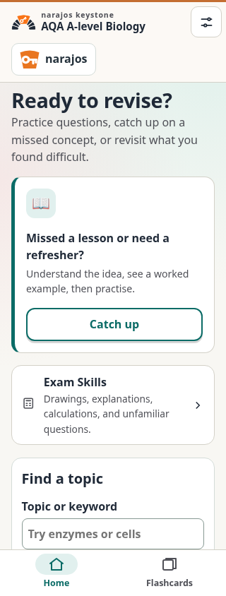
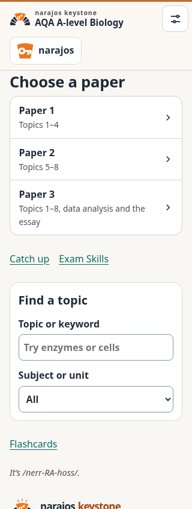
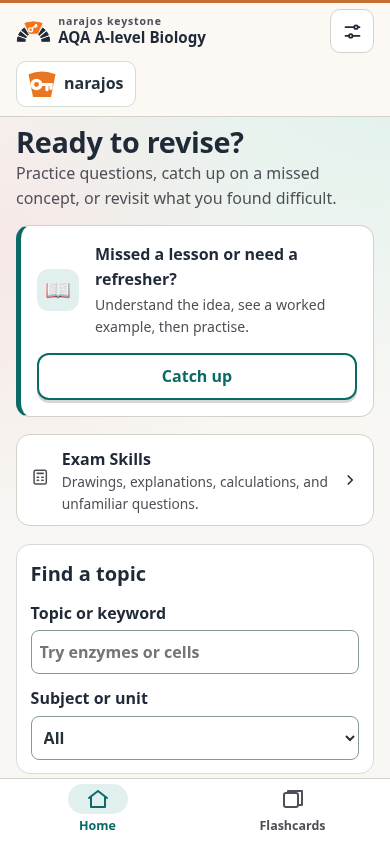
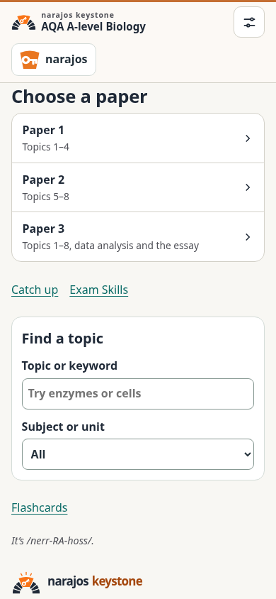
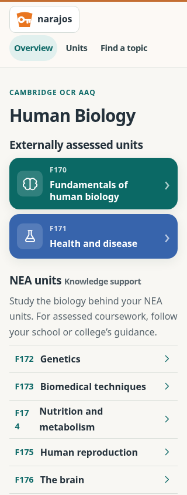
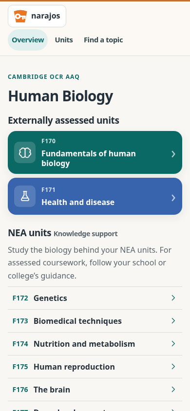
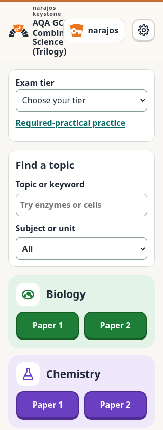
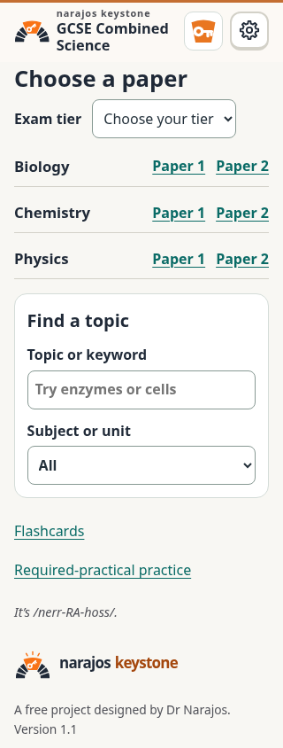
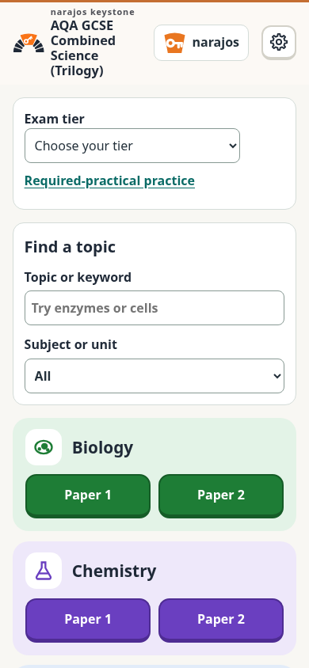
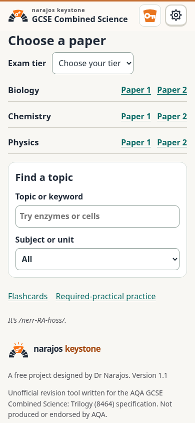

# Exam-year homepages on phones

Each pair shows the same homepage at the top of an 844 px tall viewport. **Before** is main at `081136d`. **After** is the revised PR #82. The numbers are the approximate positions from the top of the viewport, in CSS pixels.

| First course choice | 320 px before → after | 390 px before → after |
| --- | ---: | ---: |
| A-level Paper 1 | 1,219 → 160 | 1,035 → 160 |
| GCSE Biology Paper 1 | 612 → 166 | 599 → 158 |
| Human Biology F170 | 269 → 269 | 269 → 269 |
| Human Biology F171 | 365 → 365 | 365 → 365 |

**AQA A-level Biology.** All three papers are visible immediately. The Paper 2 link opens the paper, and **Topics** leads to the concept list. **Catch up** and **Exam Skills** stay visible beneath the papers. The single **Flashcards** link opens the deck chooser at both widths.

**Cambridge AAQ Human Biology.** F170 and F171 remain visible on arrival. Tapping either tile opens the unit with **Catch up**, **Practise questions**, **Flashcards** and the first topic in view at both widths. The header’s **Find a topic** link gives direct access to search.

**AQA GCSE Combined Science.** The tier selector and all six paper links fit in the first phone screen. Selecting Foundation or Higher opens the same clearly labelled paper with the appropriate topics and persists after reload. **Find a topic**, **Flashcards** and **Required-practical practice** remain below the papers.

| Course and width | Before | After |
| --- | --- | --- |
| A-level Biology at 320 px |  |  |
| A-level Biology at 390 px |  |  |
| Human Biology at 320 px |  |  |
| Human Biology at 390 px |  |  |
| GCSE at 320 px |  |  |
| GCSE at 390 px |  |  |
