# Exam-year interface simplification

The comparisons use the same learning stage before and after the change. The baseline is PR #82 at `f76807d`. The journeys were exercised in Chromium at 320 and 390 CSS pixels.

## AQA A-level Biology

Open A-level Biology, choose Paper 2 and find **Photosynthesis** under **Topics**. Choose a concept and start its questions. Choose an answer and check it. Open **Need help?** if you want a hint or explanation. After feedback, continue through the existing question sequence.

From the course home, open **Exam Skills** and select **Understand the question**. Read the key idea, then follow the worked example. The opening question remains visible as the reasoning advances. You can also go straight to the questions. During practice, use **Check answer** and continue after feedback. Clues, explanations and the worked example are available through a single help control. Returning to the activity restores the saved position.

The course home removes the introductory panels and duplicate bottom navigation. The first paper link starts around 165 px down the 320 px screen, compared with more than 1,200 px before. Exam Skills removes its five-stage strip, repeated “Start” labels and the replay control. The sampled guided question is about 330 px shorter at 320 px.

| Stage | Before | After |
| --- | --- | --- |
| Exam Skills guided question, 320 px | 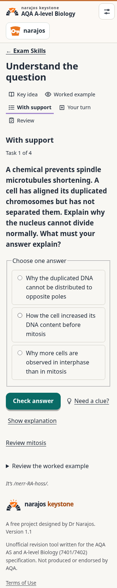 | 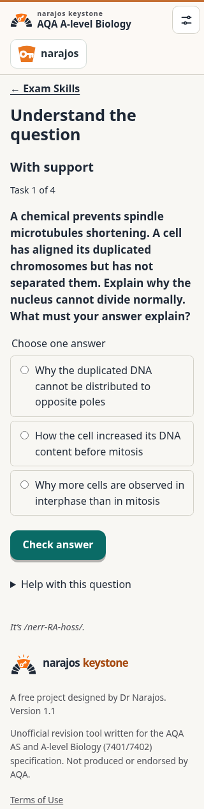 |
| Topic question, 390 px | 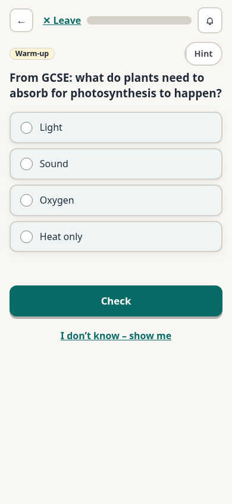 | 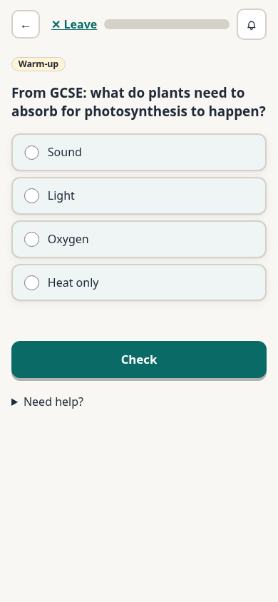 |

## Cambridge AAQ Human Biology

Open **F170** and choose **Catch up**, then find the microscopy lesson. Read the explanation and follow the worked example using the red-cell image and its scale bar. Continue to guided practice, check an answer, then apply the idea independently. The same route allows you to skip directly to independent practice. Written responses are compared against a model as self-review.

For **F171**, choose **Catch up** and open the screening lesson from the public-health area. Use the worked table to see which figures support the comparison. Move on to the independent screening question and check a response. The question’s own table remains visible, and incorrect feedback can lead to another check. Reload to resume the selected stage and the saved response.

The lessons replace simultaneously open forms with one current stage. The explanation stays on the page, while hints, explanations and earlier worked support are available on request. The title and action no longer have to compete with the other stage controls. At 320 px, the initial microscopy view drops from 3,871 px to 2,647 px and the screening view from 4,555 px to 2,847 px.

| Stage | Before | After |
| --- | --- | --- |
| F170 microscopy, independent question, 320 px | 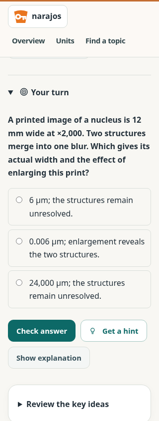 | 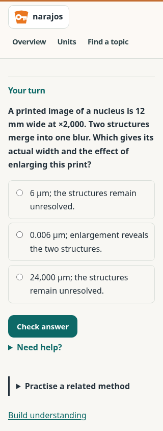 |
| F171 screening, independent question, 390 px | 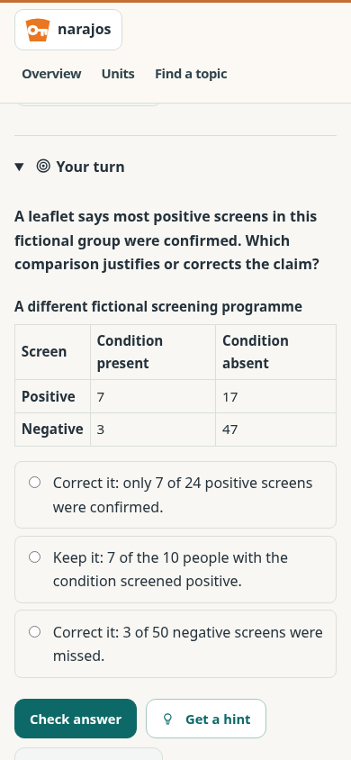 | 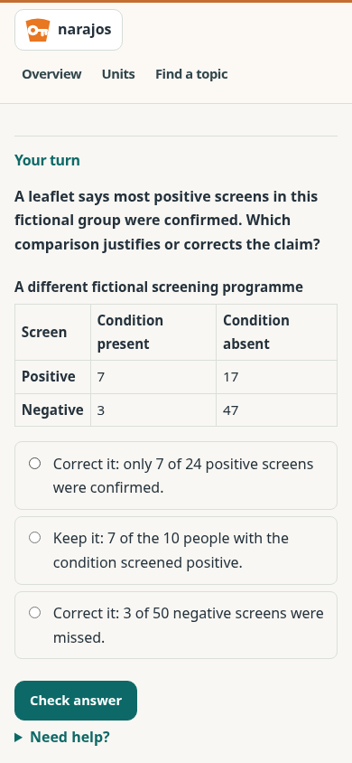 |

## AQA GCSE Combined Science

On the GCSE home page, select **Foundation** and open the relevant paper and topic to revise. Pick a concept, choose an answer and check it. Hints and explanation are available under **Need help?**. Switch to **Higher** to see the higher-tier topic material. Reloading the home page restores the selected tier.

For Year 11 Catch-up, use **Catch up on this topic** from the revision topic or choose **Year 11** in Science Catch-up. Work through the reaction rates lesson for Foundation or the motor effect lesson for Higher. Read the explanation or worked example and answer the check beside it. **Need help?** contains the clue and explanation. After feedback, continue to the next step. **Pause check** is in the lesson navigation. Reopening restores the step and feedback, and completing the lesson offers the route back to revision.

During catch-up the question area goes from four controls to **Check answer** and **Need help?**. The question evidence opens with the task. At 320 px, the Foundation reaction rates page drops from 2,221 px to 1,893 px and the Higher motor effect page from 2,523 px to 2,117 px. The GCSE revision question also replaces its separate hint and reveal controls with one help disclosure.

| Stage | Before | After |
| --- | --- | --- |
| Foundation reaction rates check, 390 px | 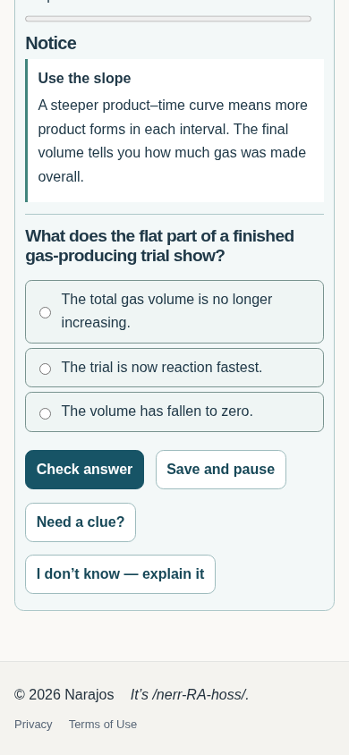 | 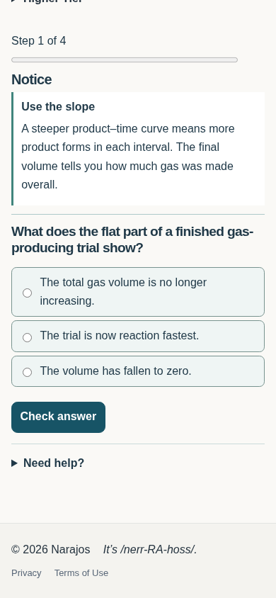 |
| Higher motor effect check, 320 px | 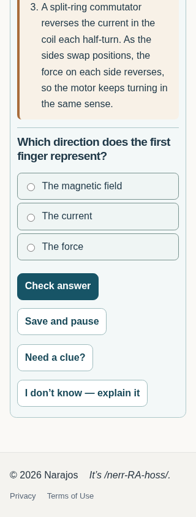 | 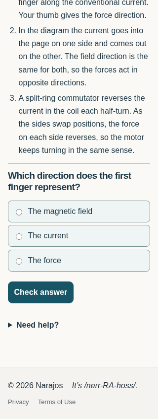 |
| Revision question, 390 px | 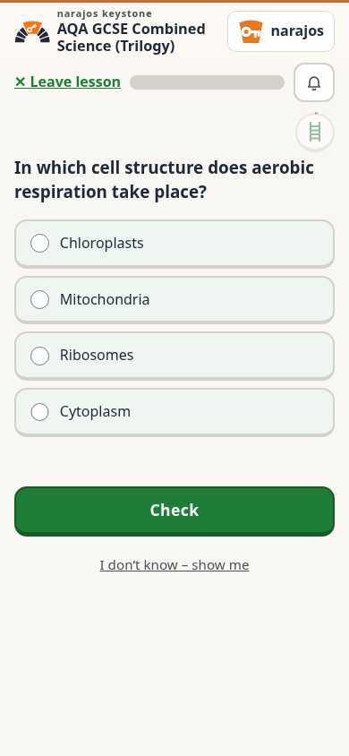 | 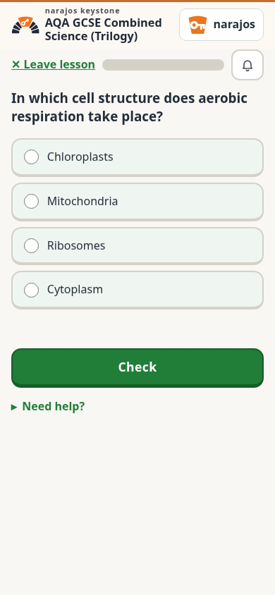 |
